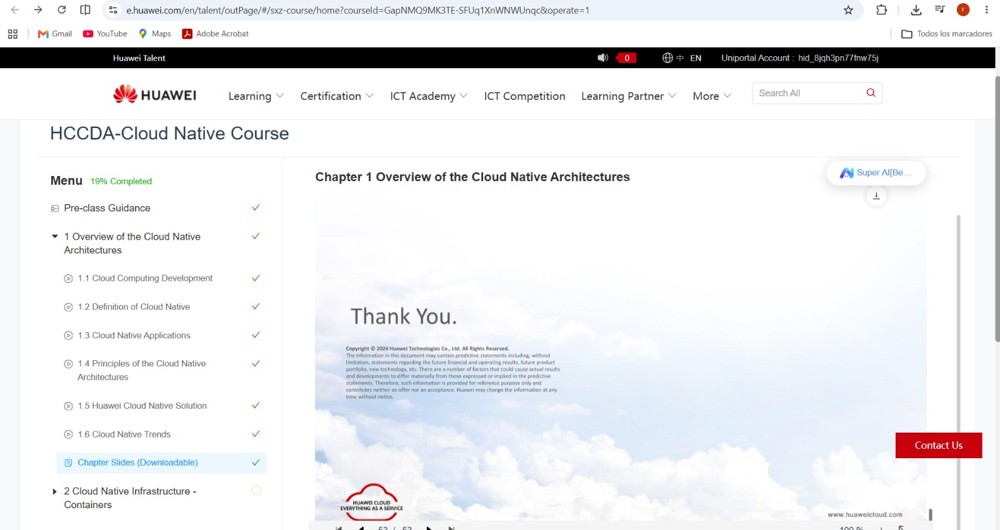
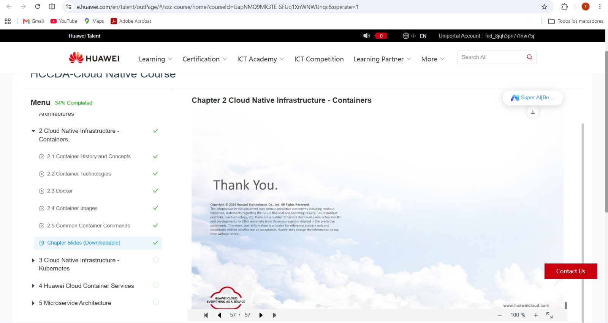
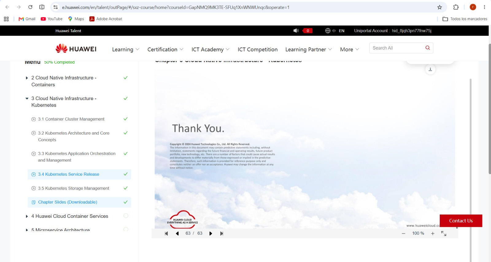
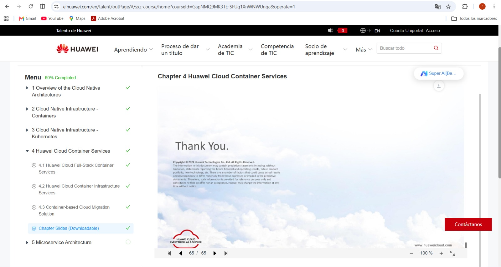
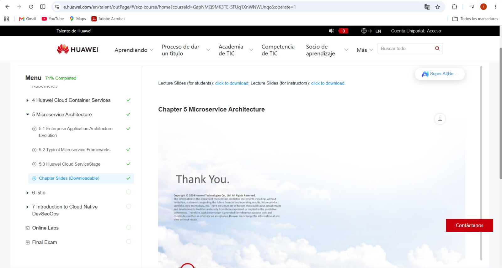
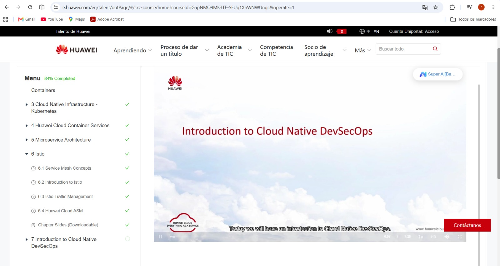
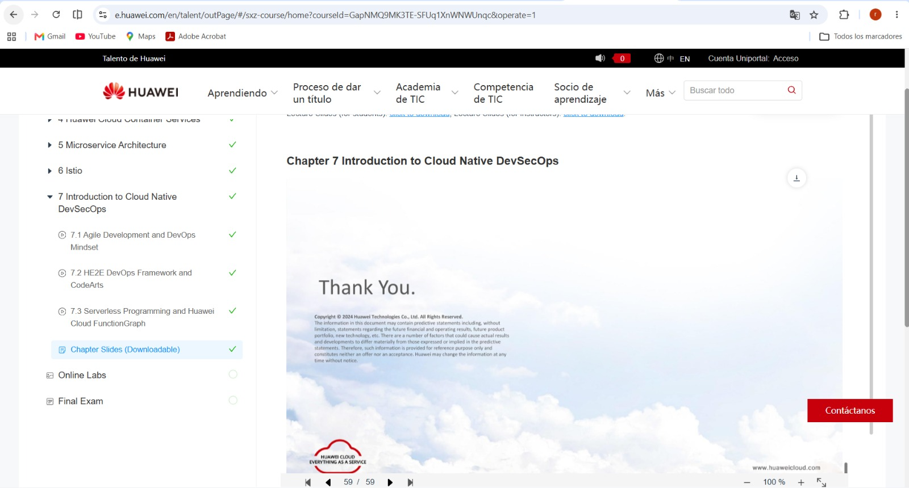
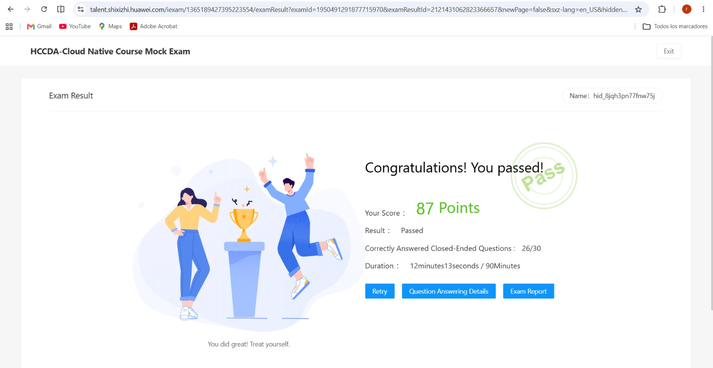
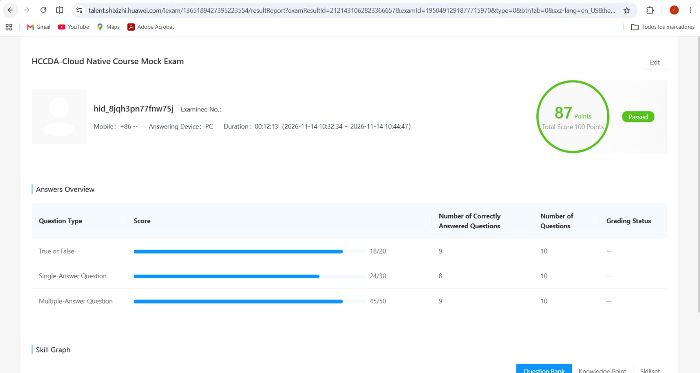
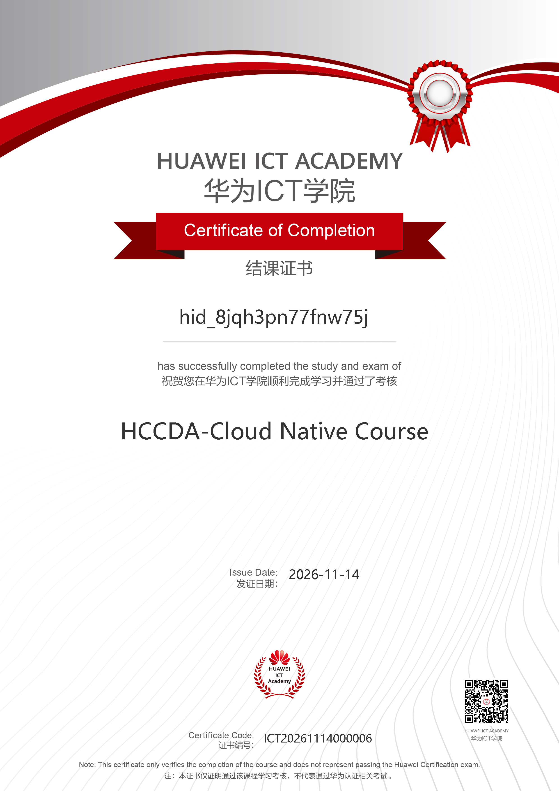

# Certificación C3 — Desarrollo Fullstack

## 1. Ficha del estudiante y del curso

| Dato | Información |
|---|---|
| Nombre completo | Rosfeller David Castillo Garzón |
| Usuario de GitHub | [Feller2006](https://github.com/Feller2006) |
| Nombre del curso | HCCDA-Cloud Native Course |
| Plataforma | Huawei ICT Academy |
| Duración publicada | 32 horas |
| Fecha de inicio | 2 de noviembre de 2026 |
| Fecha de finalización | 13 de noviembre de 2026 |
| Resultado del Mock Exam | 87/100 puntos |

**Institución:** Corporación Universitaria del Huila — CORHUILA.  
**Programa:** Ingeniería de Sistemas.  
**Asignatura:** Desarrollo Fullstack.  
**Periodo académico:** 2026-B.

## 2. Ficha del curso y certificación

[Consultar curso Huawei](https://e.huawei.com/en/talent/ict-academy/#/ict-courses-detail?courseId=tYzMjtsDe5l6wS7e33Ye5DZUn1g)

La formación aborda arquitecturas nativas de la nube, contenedores, Kubernetes, microservicios, Istio y DevSecOps.

La constancia oficial de finalización se incorporará cuando esté disponible.

## 3. Desarrollo del curso

| Capítulo | Aprendizaje |
|---|---|
| 1. Cloud Native Architectures | Comprendí los principios de las arquitecturas nativas de la nube y sus ventajas para aplicaciones escalables. |
| 2. Containers | Aprendí cómo los contenedores permiten empaquetar aplicaciones con sus dependencias. |
| 3. Kubernetes | Conocí los conceptos de Pods, Deployments, Services y escalabilidad. |
| 4. Huawei Cloud Container Services | Identifiqué servicios de Huawei Cloud para administrar aplicaciones en contenedores. |
| 5. Microservice Architecture | Comprendí cómo dividir una aplicación en servicios independientes que se comunican mediante APIs. |
| 6. Istio | Conocí el concepto de malla de servicios y su utilidad para gestionar la comunicación entre microservicios. |
| 7. Cloud Native DevSecOps | Aprendí la importancia de integrar seguridad, pruebas y automatización en el desarrollo de software. |

### Evidencias

Las capturas originales se encuentran en la carpeta `evidencias`.

### Resultado del examen de práctica

**Calificación:** 87/100 puntos.  
**Respuestas correctas:** 26 de 30.  
**Estado:** Aprobado.

## 4. Relación con Desarrollo Fullstack

Los conocimientos del curso HCCDA-Cloud Native se relacionan con el desarrollo de aplicaciones que integran frontend, backend y bases de datos.

**Contenedores:** Docker permite empaquetar los componentes de una aplicación y ejecutar sus servicios de forma consistente. Docker Compose facilita levantar varios servicios durante el desarrollo.

**Kubernetes:** En una aplicación con muchos usuarios, Kubernetes permitiría administrar múltiples réplicas del backend, distribuir solicitudes y recuperar contenedores que fallen.

**DevSecOps:** Integraría pruebas automáticas, revisión de dependencias y controles de seguridad en el flujo de GitHub para detectar problemas antes de desplegar la aplicación.

Estos conceptos complementan lo aprendido en Desarrollo Fullstack y permiten comprender cómo preparar una aplicación para funcionar en entornos de producción.

## 5. Skills Summary

I understand the fundamentals of cloud-native architectures.
I can explain how containers package applications and their dependencies.
I understand how Kubernetes manages containerized workloads.
I can identify the benefits of microservice architectures.
I understand the role of Istio in service communication.
I recognize the importance of security and automation in DevSecOps.

## 6. Evidencias de los capítulos

### Capítulo 1 — Cloud Native Architectures

### Capítulo 2 — Containers

### Capítulo 3 — Kubernetes

### Capítulo 4 — Huawei Cloud Container Services

### Capítulo 5 — Microservice Architecture

### Capítulo 6 — Istio

### Capítulo 7 — Cloud Native DevSecOps

## 7. Resultado del examen final

**Calificación:** 87/100 puntos.

**Resultado:** Aprobado.

### Reporte detallado

## 8. Certificado oficial de finalización

Se completó satisfactoriamente el curso HCCDA-Cloud Native Course de Huawei ICT Academy.

- Fecha de inicio: 2 de noviembre de 2026.
- Fecha de emisión del certificado: 14 de noviembre de 2026.
- Progreso del curso: 100 %.
- Resultado del simulacro: 87/100 puntos.
- Estado: Aprobado.

### Constancia oficial de Huawei ICT Academy

